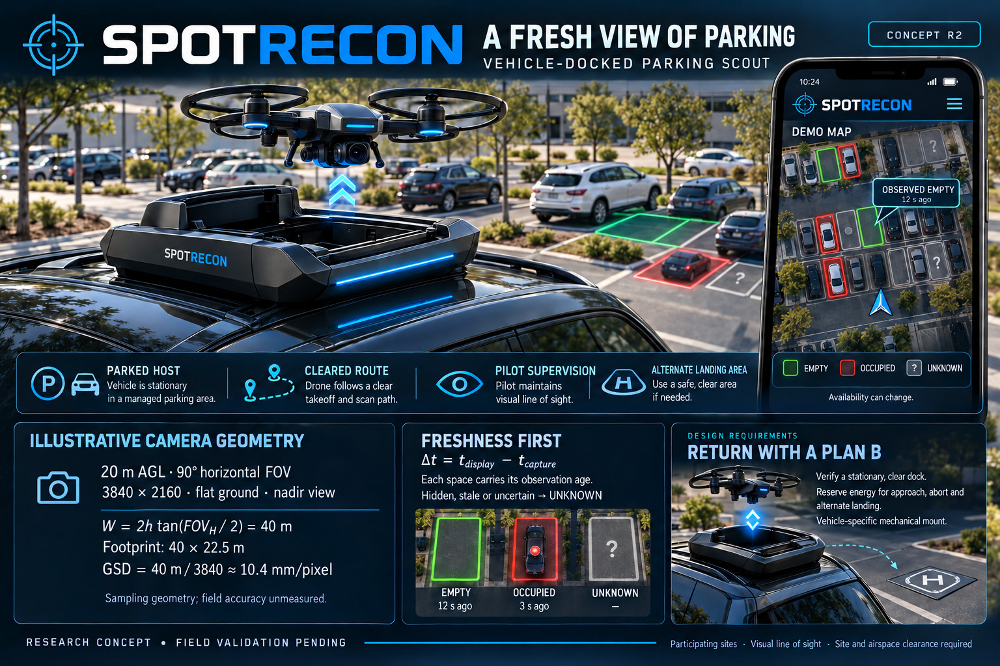

# SPOTRECON — Parking Scout

**A fresh view of parking.** SPOTRECON R2 is a concept for a pilot-supervised camera drone that launches from a stationary vehicle dock and reports recent observations of parking spaces at participating, mapped outdoor lots.

**Status:** research concept. No SPOTRECON prototype or field performance data is included.

In the poster’s demo, one space was observed empty 12 seconds ago and another
occupied 3 seconds ago. Hidden, stale, or uncertain spaces are marked **unknown**.
The times illustrate what a driver would see. Field testing is still pending.

## How the parking scout would work

A guarded quadcopter inspects a predefined, cleared route while its pilot maintains visual line of sight. The map reports **observed empty / occupied / unknown**, with capture age for each observation. Availability can change; a report does not reserve a space.

The proposed dock checks stationary vehicle state and approach clearance. Its reserve policy must fund return, a failed docking approach, diversion and alternate landing. These are requirements to validate, not demonstrated capabilities.

## In this repository

The poster illustrates the proposed flight. The two text files explain the workflow and how it could be tested.

| Resource | What it covers |
| --- | --- |
| [Vehicle dock and parking map poster (JPEG)](SPOTRECON-R2.jpg) | Final revised concept poster |
| [SPOTRECON project introduction (Markdown)](TEASER.md) | Short public introduction |
| [SPOTRECON R2 engineering review (Markdown)](COURT-REVIEW.md) | Engineering changes, assumptions, failure tests, review record and primary references |

## Checked illustrative math

For an ideal rectilinear camera looking straight down at flat ground, with square pixels, a **90° horizontal field of view**, **3840 × 2160** image and height **20 m above ground**:

$$
W = 2h\tan(\phi_H/2) = 40\ \mathrm{m}
$$

$$
H = W\frac{2160}{3840} = 22.5\ \mathrm{m}
$$

$$
A = WH = 900\ \mathrm{m^2}
$$

$$
\mathrm{GSD} = \frac{W}{3840} \approx 10.4\ \mathrm{mm/pixel}
$$

Under these assumptions, one frame covers 40 m by 22.5 m, or 900 square metres. Each pixel spans about 10.4 mm on the ground. Field tests would have to measure optical resolution, parking-space classification accuracy, and location error. The example altitude is an assumption, not an approved operating limit.

A 150 m-radius disk covers approximately **70,686 m²**, or **78.5 such frame areas** before overlap, occlusions and route margins. Operating radius and area surveyed are separate quantities.

Subtract the capture time from the display time, using a common clock, to find the age of each observation.

$$
\Delta t = t_{\mathrm{display}} - t_{\mathrm{capture}}
$$

Hidden, stale or uncertain spaces become **unknown**. The age limit requires validation.

To continue a flight, the lower estimate of remaining energy must cover the upper estimates for return, a docking attempt and abort, diversion and landing, plus a margin.

$$
E_{\mathrm{remaining,lower}} \ge E_{\mathrm{return,upper}} + E_{\mathrm{approach/abort,upper}} + E_{\mathrm{divert/land,upper}} + E_{\mathrm{margin}}
$$

Each energy term and uncertainty bound needs measurements on the configured aircraft.

## What R2 changes

- Removes unsupported radius, flight-time, accuracy, wind and rain figures.
- Replaces universal suction/magnetic mounting with a vehicle-specific mechanical attachment requiring qualification.
- Adds observation age and an explicit unknown state to the map.
- Separates advisory parking information from onboard flight safety.
- Requires a cleared flight corridor, an available alternate landing area and a tested policy for combined dock, navigation and link failures.

The intended first investigation is a participating outdoor lot surveyed from a parked staff vehicle. Airspace, site access, pilot and aircraft requirements remain operation-specific.

## Evidence and next gate

The present evidence consists of calculations and a structured design review. **There is no claimed prototype, simulation result, flight test, field accuracy, docking reliability, weather qualification or regulatory approval.**

The next gate is controlled validation: first fixed-pad docking and fault injection, then qualified vehicle mounting and blinded occupancy trials. Measure false-vacancy errors alongside useful coverage, map error and observation age. Record all aborts and failures.

## Review provenance

Concept direction: **Ray Peloquin**. Revision prepared with **Codex** using the Synthetic Court review process. Grok, Claude and Gemini returned AI reviews; selected suggestions were independently checked and some were corrected or rejected. Meta AI did not complete a technical review. These consultations are not endorsements or experimental evidence.

See [the SPOTRECON R2 engineering review](COURT-REVIEW.md) for the accepted findings and primary references. This repository documents a concept; it contains no flight-control software or operational deployment package.

